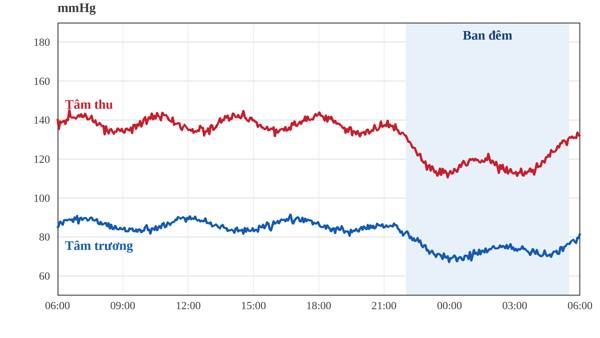

::: {custom-style="Chapter Number"}
Chương 1
:::

::: {custom-style="Title"}
Tăng huyết áp
:::

::: {custom-style="Box Title"}
Điểm chính
:::

::: {custom-style="Key Points"}
Tăng huyết áp là yếu tố nguy cơ tim mạch có thể thay đổi được, phổ biến nhất trên thế giới.
:::

::: {custom-style="Key Points"}
Chẩn đoán dựa trên nhiều lần đo đúng kỹ thuật, nên kết hợp đo huyết áp tại nhà hoặc Holter 24 giờ.
:::

::: {custom-style="Key Points"}
Thay đổi lối sống là nền tảng; phần lớn người bệnh cần phối hợp từ hai thuốc trở lên để đạt mục tiêu.
:::

# Đại cương

Tăng huyết áp (THA) được định nghĩa khi huyết áp tâm thu đo tại phòng khám ≥ 140 mmHg và/hoặc huyết áp tâm trương ≥ 90 mmHg, sau nhiều lần đo đúng kỹ thuật[^1]. Theo Tổ chức Y tế Thế giới, khoảng 1,28 tỷ người trưởng thành từ 30 đến 79 tuổi mắc THA, và gần một nửa trong số đó không biết mình mắc bệnh[^2].

THA thường không có triệu chứng trong nhiều năm, vì vậy được gọi là "kẻ giết người thầm lặng". Bệnh làm tăng nguy cơ đột quỵ, nhồi máu cơ tim, suy tim, bệnh thận mạn và sa sút trí tuệ. Giảm 10 mmHg huyết áp tâm thu giúp giảm đáng kể các biến cố tim mạch lớn.

Về sinh lý bệnh, huyết áp phụ thuộc vào cung lượng tim và sức cản mạch ngoại biên. Hệ renin–angiotensin–aldosteron (RAA), hệ thần kinh giao cảm, sự ứ natri (Na^+^) và rối loạn chức năng nội mô đều tham gia vào cơ chế bệnh sinh.

# Phân loại

Phân loại theo trị số huyết áp đo tại phòng khám được trình bày trong Bảng 1.1. Khi huyết áp tâm thu và tâm trương thuộc hai mức khác nhau, xếp theo mức cao hơn.

: Bảng 1.1. Phân loại huyết áp đo tại phòng khám (mmHg)

| Phân loại | Tâm thu | | Tâm trương |
|---|---|---|---|
| Tối ưu | < 120 | và | < 80 |
| Bình thường | 120–129 | và/hoặc | 80–84 |
| Bình thường cao | 130–139 | và/hoặc | 85–89 |
| THA độ 1 | 140–159 | và/hoặc | 90–99 |
| THA độ 2 | 160–179 | và/hoặc | 100–109 |
| THA độ 3 | ≥ 180 | và/hoặc | ≥ 110 |
| THA tâm thu đơn độc | ≥ 140 | và | < 90 |

Huyết áp dao động theo nhịp ngày đêm: thường giảm 10–20% khi ngủ. Mất trũng huyết áp ban đêm ("non-dipper") liên quan đến tăng nguy cơ tim mạch (Hình 1.1).

# Chẩn đoán

## Đo huyết áp đúng kỹ thuật

Sai số khi đo là nguyên nhân thường gặp của chẩn đoán sai. Quy trình đo tại phòng khám gồm các bước:

1. Người bệnh ngồi nghỉ 3–5 phút trong phòng yên tĩnh, không hút thuốc hay uống cà phê trong 30 phút trước đó.
2. Dùng băng quấn phù hợp với chu vi cánh tay; đặt băng quấn ngang mức tim.
3. Đo 3 lần, cách nhau 1–2 phút; lấy trung bình của 2 lần cuối.
4. Lần khám đầu tiên đo cả hai tay; các lần sau đo ở tay có trị số cao hơn.

## Đánh giá tổn thương cơ quan đích

Cần tìm các tổn thương do THA gây ra, vì chúng làm thay đổi phân tầng nguy cơ và lựa chọn điều trị:

- Tim: phì đại thất trái trên điện tâm đồ hoặc siêu âm tim.
- Thận: mức lọc cầu thận ước tính (eGFR) giảm, albumin niệu.
- Mạch máu: mảng xơ vữa động mạch cảnh, chỉ số cổ chân–cánh tay thấp.
- Mắt: bệnh võng mạc do THA (xuất huyết, xuất tiết, phù gai thị).

Chụp X-quang ngực có thể thấy bóng tim to ở người bệnh THA lâu năm (Hình 1.2), tuy nhiên đây là dấu hiệu muộn và kém nhạy.

# Điều trị

## Thay đổi lối sống

- Giảm muối: dưới 5 g muối mỗi ngày.
- Tăng rau quả, chế độ ăn kiểu DASH hoặc Địa Trung Hải.
- Giảm cân nếu thừa cân; duy trì vòng eo hợp lý.
- Hoạt động thể lực mức trung bình ít nhất 150 phút mỗi tuần.
- Hạn chế rượu bia, bỏ hoàn toàn thuốc lá.

## Thuốc hạ huyết áp

Năm nhóm thuốc chính có bằng chứng giảm biến cố tim mạch gồm: ức chế men chuyển (ƯCMC), chẹn thụ thể angiotensin II (CTTA), chẹn kênh canxi (CKCa), lợi tiểu thiazid hoặc giống thiazid, và chẹn beta. Với đa số người bệnh, nên khởi đầu bằng phối hợp hai thuốc trong một viên.

: Bảng 1.2. Một số thuốc hạ huyết áp thường dùng (liều tham khảo cho người lớn)

| Nhóm | Thuốc | Liều hằng ngày | Lưu ý |
|---|---|---|---|
| ƯCMC | Lisinopril | 10–40 mg | Ho khan, phù mạch; chống chỉ định khi có thai |
| CTTA | Losartan | 50–100 mg | Theo dõi kali máu và creatinin |
| CKCa | Amlodipin | 5–10 mg | Phù cổ chân |
| Lợi tiểu | Indapamid SR | 1,5 mg | Hạ kali, tăng acid uric |
| Chẹn beta | Bisoprolol | 2,5–10 mg | Ưu tiên khi có suy tim, bệnh mạch vành |

::: {custom-style="Block Text"}
Lưu ý: không phối hợp ƯCMC với CTTA vì tăng nguy cơ tăng kali máu và tổn thương thận cấp mà không thêm lợi ích.
:::

Mục tiêu điều trị chung là huyết áp phòng khám < 140/90 mmHg, và nếu dung nạp tốt thì hạ xuống khoảng 120–130/70–80 mmHg ở phần lớn người bệnh dưới 65 tuổi.

# Tài liệu tham khảo

::: {custom-style="Reference"}
1\. Williams B, Mancia G, Spiering W, et al. 2018 ESC/ESH Guidelines for the management of arterial hypertension. Eur Heart J. 2018;39(33):3021–3104.
:::

::: {custom-style="Reference"}
2\. World Health Organization. Global report on hypertension: the race against a silent killer. Geneva: WHO; 2023.
:::

[^1]: Ngưỡng chẩn đoán theo Hướng dẫn ESC/ESH 2018.

[^2]: Số liệu trong Báo cáo toàn cầu về tăng huyết áp của WHO năm 2023.
