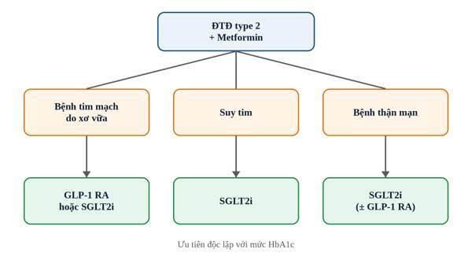

::: {custom-style="Chapter Number"}
Chương 2
:::

::: {custom-style="Title"}
Đái tháo đường type 2
:::

# Đại cương

Đái tháo đường type 2 (ĐTĐ type 2) là rối loạn chuyển hóa mạn tính đặc trưng bởi tăng glucose máu, do kết hợp giữa đề kháng insulin và suy giảm tiến triển chức năng tế bào beta tụy. Đây là thể bệnh chiếm khoảng 90% số người mắc đái tháo đường.

Các yếu tố nguy cơ chính gồm thừa cân, béo bụng, ít vận động, tiền sử gia đình, tiền sử đái tháo đường thai kỳ và tuổi cao. Tăng glucose máu kéo dài gây biến chứng mạch máu nhỏ (võng mạc, thận, thần kinh) và mạch máu lớn (bệnh mạch vành, đột quỵ, bệnh động mạch ngoại biên).

# Chẩn đoán

Chẩn đoán đái tháo đường khi có một trong các tiêu chuẩn trong Bảng 2.1[^1]. Nếu không có triệu chứng tăng glucose máu rõ ràng, cần xét nghiệm lại lần hai để khẳng định.

: Bảng 2.1. Tiêu chuẩn chẩn đoán đái tháo đường

| Xét nghiệm | Ngưỡng chẩn đoán |
|---|---|
| HbA~1c~ | ≥ 6,5% (48 mmol/mol) |
| Glucose huyết tương lúc đói (nhịn ăn ≥ 8 giờ) | ≥ 126 mg/dL (7,0 mmol/L) |
| Glucose huyết tương 2 giờ sau nghiệm pháp dung nạp 75 g glucose | ≥ 200 mg/dL (11,1 mmol/L) |
| Glucose huyết tương bất kỳ, kèm triệu chứng kinh điển | ≥ 200 mg/dL (11,1 mmol/L) |

Triệu chứng kinh điển gồm uống nhiều, tiểu nhiều, ăn nhiều và sụt cân không rõ nguyên nhân. Xét nghiệm HbA~1c~ có thể sai lệch khi người bệnh thiếu máu, có bệnh huyết sắc tố hoặc mới truyền máu.

# Điều trị

## Nguyên tắc chung

Điều trị lấy người bệnh làm trung tâm: mục tiêu HbA~1c~ thường < 7%, có thể nới lỏng ở người cao tuổi, nhiều bệnh kèm theo hoặc dễ bị hạ glucose máu. Bên cạnh kiểm soát glucose, cần kiểm soát đồng thời huyết áp, lipid máu và cân nặng.

## Lựa chọn thuốc

Metformin vẫn là thuốc nền tảng cho phần lớn người bệnh nếu không có chống chỉ định. Ở người bệnh có bệnh tim mạch do xơ vữa, suy tim hoặc bệnh thận mạn, ưu tiên thuốc ức chế SGLT2 hoặc đồng vận thụ thể GLP-1 có lợi ích tim–thận đã được chứng minh, độc lập với mức HbA~1c~ (Hình 2.1).

1. Có bệnh tim mạch do xơ vữa: ưu tiên đồng vận GLP-1 hoặc ức chế SGLT2.
2. Có suy tim: ưu tiên ức chế SGLT2.
3. Có bệnh thận mạn: ưu tiên ức chế SGLT2; dùng đồng vận GLP-1 nếu không dung nạp.
4. Cần giảm cân nhiều: cân nhắc đồng vận GLP-1 hoặc đồng vận kép GIP/GLP-1.

Insulin được chỉ định khi HbA~1c~ rất cao (thường > 10%), có triệu chứng dị hóa rõ hoặc khi các thuốc khác không đạt mục tiêu.

# Tài liệu tham khảo

::: {custom-style="Reference"}
1\. American Diabetes Association Professional Practice Committee. 2. Diagnosis and Classification of Diabetes: Standards of Care in Diabetes—2024. Diabetes Care. 2024;47(Suppl 1):S20–S42.
:::

[^1]: Theo Tiêu chuẩn chăm sóc đái tháo đường của Hiệp hội Đái tháo đường Hoa Kỳ (ADA) năm 2024.
